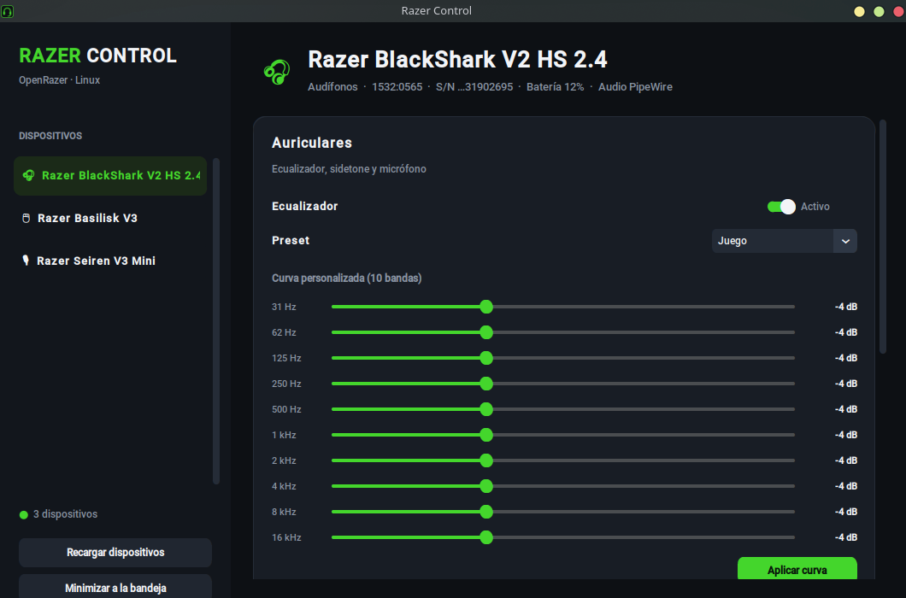

# Razer Control

Aplicación de escritorio ligera para Linux que reúne el control de tus
dispositivos Razer en una sola interfaz oscura, con icono en el menú de
aplicaciones y en la bandeja del sistema.



## Características

- Detección automática de dispositivos Razer mediante OpenRazer y USB (`sysfs`).
- Ratones: DPI, brillo, efectos Chroma (estático y espectro) y batería.
- Auriculares: batería, carga, ecualizador (on/off, preset y curva de 10
  bandas), sidetone, modo «no molestar» y estado del micrófono.
- Audio con PipeWire o PulseAudio: volumen, mute y ganancia de micrófono
  mediante `pactl`.
- Funciona aunque falte el demonio, los permisos o `python-openrazer`: muestra
  el dispositivo, su audio y un aviso con instrucciones para arreglarlo.
- Bandeja del sistema con **Mostrar** y **Salir**; la ventana se puede ocultar
  y la aplicación sigue activa en segundo plano.

## Requisitos

| Componente | Arch Linux y derivadas | Debian, Ubuntu y derivadas |
|---|---|---|
| Python + Tk | `python tk` | `python3 python3-tk python3-venv` |
| customtkinter | lo instala `install.sh` | lo instala `install.sh` |
| Bandeja | `libappindicator python-gobject` | `python3-gi gir1.2-ayatanaappindicator3-0.1` |
| Audio | `pipewire-pulse` o `pulseaudio` (`pactl`) | `pipewire-pulse` o `pulseaudio-utils` |
| OpenRazer (opcional) | `openrazer-daemon python-openrazer openrazer-driver-dkms` | `openrazer-daemon python3-openrazer openrazer-driver-dkms` |

`install.sh` crea un entorno virtual en `/opt/razer-control/venv` e instala
`customtkinter` ahí; la primera vez necesita conexión a internet.

### Bandeja según el escritorio

- **KDE Plasma**: funciona de forma nativa (AppIndicator/StatusNotifier).
- **GNOME**: requiere la extensión `gnome-shell-extension-appindicator`
  (Arch: `sudo pacman -S gnome-shell-extension-appindicator`, Debian/Ubuntu:
  `sudo apt install gnome-shell-extension-appindicator`).
- **XFCE, Cinnamon, MATE, Budgie**: usan AppIndicator o tienen un plugin
  compatible; si no aparece el icono, instala el soporte de bandeja de tu
  escritorio.
- La app detecta si la bandeja no está disponible y, en ese caso, minimiza la
  ventana de la forma habitual avisando en la interfaz.

## Instalar OpenRazer (opcional, necesario para DPI/RGB)

La aplicación arranca sin OpenRazer, pero para controlar DPI, iluminación,
batería y ecualizador necesitas el demonio y la librería de Python.

### Arch Linux

```bash
sudo pacman -S openrazer-daemon python-openrazer openrazer-driver-dkms
sudo gpasswd -a "$USER" openrazer
systemctl --user enable --now openrazer-daemon
```

Cierra sesión y vuelve a entrar para que se aplique el grupo.

### Debian 13 (trixie), sid y derivadas

```bash
sudo apt install openrazer-daemon python3-openrazer openrazer-driver-dkms
sudo gpasswd -a "$USER" plugdev
systemctl --user enable --now openrazer-daemon
```

En Debian 12 los paquetes existen pero son más antiguos; si tu dispositivo no
aparece, usa los backports o los paquetes experimentales de más abajo.

### Ubuntu y derivadas

```bash
sudo add-apt-repository ppa:openrazer/stable
sudo apt update
sudo apt install openrazer-daemon python3-openrazer openrazer-driver-dkms
sudo gpasswd -a "$USER" plugdev
systemctl --user enable --now openrazer-daemon
```

En algunas versiones el grupo de las reglas udev es `openrazer` en lugar de
`plugdev`; comprueba `/usr/lib/udev/rules.d/` y añade el grupo que corresponda.
Después de cambiar de grupo, cierra sesión y vuelve a entrar.

## Instalar Razer Control

```bash
git clone https://github.com/mauspancho/razer-control.git
cd razer-control
./install.sh
```

Si no eres root, el instalador se relanza con `pkexec` (o te indica usar
`sudo`). El script:

1. Comprueba `tkinter`, `python3-venv`, `python-gobject`/`AppIndicator3` y
   avisa de lo que falte con el comando exacto para Arch o Debian/Ubuntu.
2. Copia la aplicación a `/opt/razer-control` y crea su entorno virtual.
3. Instala el comando `/usr/local/bin/razer-control`.
4. Instala los iconos en `/usr/share/icons/hicolor` y la entrada
   `/usr/share/applications/razer-control.desktop`.
5. Opcionalmente, añade el inicio automático en la bandeja.

Opciones:

```bash
./install.sh              # instalación normal
./install.sh --autostart  # además, arranca oculta en la bandeja al iniciar sesión
./install.sh --help       # ayuda
```

## Uso

```bash
razer-control            # abre la ventana
razer-control --tray     # arranca oculta en la bandeja (también --hidden)
razer-control --help     # opciones
```

También puedes abrirla desde el menú de aplicaciones como **Razer Control**, o
usar la acción **Abrir en segundo plano** del propio menú.

### Diagnóstico

```bash
razer-control --diagnose
razer-control --version
```

`--diagnose` muestra en un vistazo la distribución, la sesión, el kernel en uso
frente a los instalados, el estado del demonio, la versión de OpenRazer, los
dispositivos con sus capacidades, DKMS, la bandeja y el audio. Es la forma más
rápida de comprobar si una actualización del sistema afectó a la aplicación.

### Bandeja y segundo plano

- El botón **Minimizar a la bandeja** oculta la ventana y mantiene la app
  activa.
- Cerrar la ventana con la X también la oculta; para terminar de verdad usa
  **Salir** en el menú del icono de bandeja.
- El icono se coloca junto a los de red, volumen y batería. Si el panel está
  lleno, puede quedar dentro del desplegable: ábrelo y arrastra el icono fuera,
  o configura la bandeja para mostrar siempre todas las entradas.

## Desinstalar

```bash
pkexec ./uninstall.sh
```

Elimina `/opt/razer-control`, el comando, los iconos, la entrada del menú y el
autostart. **No modifica OpenRazer** ni sus paquetes.

## Dispositivos probados

| Dispositivo | USB | OpenRazer | Audio |
|---|---|---|---|
| Razer Basilisk V3 | `1532:0099` | Completo | — |
| Razer BlackShark V2 HS 2.4 | `1532:0565` | Completo con paquetes experimentales | Volumen y mute |
| Razer Seiren V3 Mini | `1532:056a` | No soportado | Ganancia y mute |

### Soporte experimental del BlackShark V2 HS (solo Arch)

La carpeta [`experimental/`](experimental/README.md) contiene paquetes locales
del fork `AlexandreFournier/openrazer` (rama `blackshark-v2-hyperspeed`) que
añaden el driver `razerblackshark` para `1532:0565` y `1532:056e`.

Con esos paquetes el headset expone batería, firmware, serie, EQ, sidetone, DND
y el estado del micrófono, y la interfaz los integra. La instalación sustituye
los paquetes oficiales `3.12.4-1` por `3.12.4.blackshark-1` y puede revertirse
con `experimental/rollback.sh`.

> Los paquetes experimentales son específicos de Arch Linux (`.pkg.tar.zst`).
> En Debian/Ubuntu la app funciona con los paquetes oficiales, pero el
> BlackShark puede quedar sin EQ ni batería hasta que el soporte llegue a
> OpenRazer estable.

## Arquitectura

```text
main.py            Punto de entrada y opciones --tray/--hidden/--diagnose
version.py         Versión de la aplicación
diagnostics.py     Informe de sistema, OpenRazer, DKMS, bandeja y audio
ui.py              Interfaz CustomTkinter, tarjetas por capacidad y bandeja
tray_service.py    Icono AppIndicator/StatusNotifier en un hilo GTK propio
razer_service.py   Backend OpenRazer (HID)
audio_service.py   Backend de audio PipeWire/PulseAudio
usb_service.py     Enumeración USB vía sysfs
assets/icons/      Iconos SVG/PNG para el menú, la ventana y la bandeja
packaging/         Entrada .desktop del menú de aplicaciones
experimental/      Paquetes OpenRazer con soporte BlackShark (Arch)
install.sh         Instalación en /opt, comando, icono, menú y autostart
uninstall.sh       Desinstalación sin tocar OpenRazer
```

La interfaz cruza las tres fuentes por VID/PID y ruta USB:

- Un dispositivo de OpenRazer muestra sus tarjetas de DPI e iluminación.
- Si expone las capacidades de headset, se añade la tarjeta de auriculares.
- Si además tiene tarjeta de audio, se añade control de volumen y mute.
- Un dispositivo Razer no soportado por OpenRazer aparece igualmente en la
  barra lateral, con su audio funcional y una tarjeta de compatibilidad.

## Desarrollo sin instalar

```bash
python3 -m venv --system-site-packages .venv
.venv/bin/pip install -r requirements.txt
.venv/bin/python main.py
```

Para el icono de bandeja hacen falta además `python-gobject` y
`libappindicator` del sistema (ver la tabla de requisitos).

## Solución de problemas

**Acabo de actualizar el kernel o el driver de Razer.**

DKMS recompila el módulo automáticamente al instalar un kernel nuevo, pero el
sistema sigue usando el kernel anterior hasta que reinicias:

```bash
razer-control --diagnose   # avisa si hay un kernel más nuevo instalado
dkms status
uname -r
modinfo razerblackshark
```

Reinicia para cargar el módulo del kernel nuevo. Si el módulo no aparece tras el
reinicio, reinstala `openrazer-driver-dkms` y vuelve a comprobar `dkms status`.

Los paquetes experimentales están fijados a `3.12.4.blackshark-1`. Una versión
oficial superior (por ejemplo `3.12.5`) puede reemplazarlos en un `pacman -Syu`;
en ese caso vuelve a ejecutar `experimental/install.sh` o añade temporalmente
`IgnorePkg` como se explica en [`experimental/README.md`](experimental/README.md).
OpenRazer oficial todavía no incluye el driver `razerblackshark`, así que el
fork sigue siendo necesario para el BlackShark.

**El menú de KDE muestra la entrada sin icono.** El escritorio conservó la
caché anterior:

```bash
systemctl --user restart plasma-plasmashell
```

Si persiste, cierra sesión y vuelve a entrar.

**No aparece el icono de bandeja.** Comprueba que `Gtk` y `AppIndicator3` se
pueden importar:

```bash
python3 -c 'import gi; gi.require_version("AppIndicator3", "0.1"); from gi.repository import AppIndicator3; print("ok")'
```

En GNOME instala `gnome-shell-extension-appindicator` y activa la extensión.

**OpenRazer no responde.**

```bash
systemctl --user status openrazer-daemon
lsusb | grep -i 1532
groups
```

Asegúrate de ejecutar la app dentro de tu sesión gráfica y sin `sudo`.

**No hay audio o faltan dispositivos de sonido.**

```bash
pactl info
pactl -f json list cards
```

**`pip` o `venv` no están disponibles en Debian/Ubuntu.**

```bash
sudo apt install python3-venv python3-pip
```

## Notas

- No se necesita root para usar la aplicación, solo para instalarla o
  desinstalarla.
- La app no modifica archivos de configuración de OpenRazer.
- Probada en KDE Plasma 6 con Wayland; debería funcionar en X11 y en otros
  escritorios que soporten AppIndicator.
